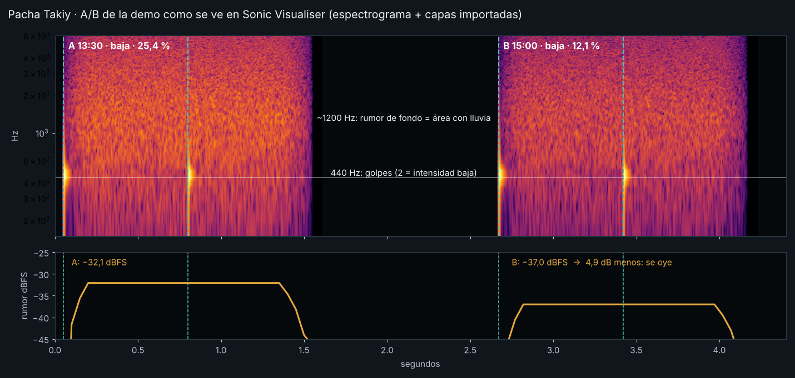
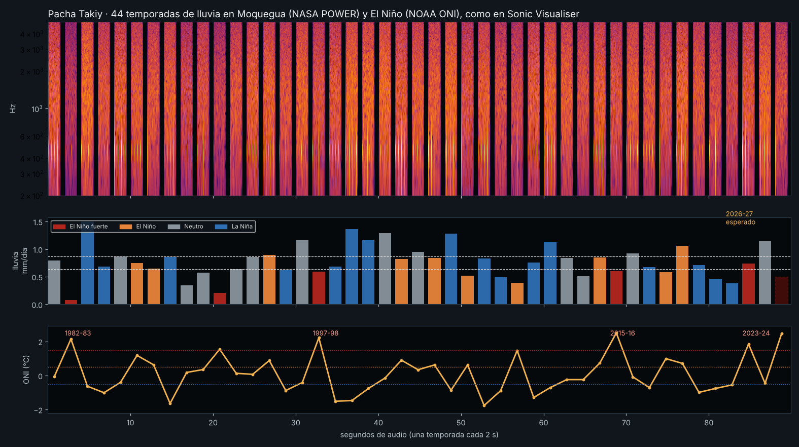

# Pacha Takiy · Ver, escuchar y sentir la lluvia de Moquegua y El Niño

**Pruébalo aquí:** https://azxim.github.io/pacha-takiy-acustica/

Pacha Takiy, del equipo **Ayni Orbital** (Moquegua, Perú), convierte la lluvia medida por los satélites de la NASA en sonido, vibración y texto. Lo hizo para el NASA Space Apps Challenge 2026, reto *The Earth Information Jukebox*. La regla:

- **Golpes de 440 Hz = intensidad:** 2 golpes es baja, 4 es media y 7 es alta.
- **Rumor de fondo = área con lluvia:** cuanto más fuerte, más área de la zona está lloviendo.

Este repositorio demuestra con mediciones que eso se cumple, lo ubica en el mapa de Moquegua y lo **calibra con El Niño**, que está presente hoy. Todo se puede comprobar viendo, escuchando o sintiendo.

## Accesible de tres formas

| Para | Cómo lo comprueba |
|---|---|
| **Personas sordas** (modo *Ver*) | Los golpes aparecen como puntos que se llenan, sin destellos (WCAG 2.3.1). El rumor se ve como llovizna y barra, con subtítulos, espectrograma y mapa de Moquegua celda por celda. |
| **Personas ciegas** (modo *Escuchar*) | El lector de pantalla describe el momento, incluido **dónde llueve** ("al noreste, en la cuenca alta hacia Carumas"), al pausar o al cambiar con las flechas, nunca encima del sonido. Se maneja con teclado. |
| **Personas sordociegas** | Vibración en cada golpe; **"Sentir el área"** (más pulsos seguidos = más lluvia) y **"Comparar A y B al tacto"**. |

## El Niño en Moquegua (calibración con datos de NASA)

Hoy hay **El Niño**:
- **NOAA** mantiene su aviso de El Niño, con Niño 3.4 en +2,5 °C (12/11/2026).
- **ENFEN** mantiene la alerta de El Niño Costero, de magnitud extraordinaria hasta febrero de 2027 (13/11/2026).

¿Qué ha significado El Niño para la lluvia de la cuenca alta de Moquegua? Lo responden 44 temporadas reales (diciembre a marzo, 1981-82 a 2024-25) de **NASA POWER** con el índice **ONI** de NOAA:

- **Con El Niño llueve menos:** correlación −0,40, con p = 0,006 por permutación.
- **4 de 5 temporadas con El Niño fuerte fueron "bajo lo normal"**, según los terciles de la normal OMM 1991–2020. Validado dejando una temporada fuera: 80 % de aciertos frente al 33 % del azar (p = 0,045).
- **Para 2026–27, la historia espera una temporada bajo lo normal** (~0,50 mm/día). Es evidencia histórica; el pronóstico oficial es de SENAMHI y ENFEN.

Suena con el mismo vocabulario de la app: 2 / 4 / 7 golpes son bajo / normal / sobre lo normal, y el rumor sigue la lluvia.

Detalle: [reportes/el-nino-moquegua.md](reportes/el-nino-moquegua.md) · datos con su fuente y fecha: [datos/](datos/).

## Verificación del sonido

| Qué se midió | Resultado |
|---|---|
| Golpes de cada momento | Exactos (2, 4 o 7), con 1,9 ms de error máximo |
| Audio real de la web frente al modelo matemático | ±0,17 dB |
| ¿El rumor tapa algún golpe? | No: 42 dB o más de margen en la banda crítica del oído |
| Demo A (13:30, 25,4 %) frente a B (15:00, 12,1 %) | 4,9 dB de diferencia: se oye con claridad |
| Las 44 temporadas y lo esperado para 2026–27 | 45 de 45 suenan como dice la regla |
| ¿La respuesta A/B es robusta? | A − B = 13,3 puntos, IC 95 % de 5,0 a 21,9 (no incluye 0) |

Detalle: [reportes/reporte-acustico.md](reportes/reporte-acustico.md).

## Sonic Visualiser (doble clic)

Descarga la carpeta [sonic-visualiser](sonic-visualiser/) y haz doble clic en **`ab_demo.sv`** o **`temporadas.sv`**: se abre el audio con el espectrograma, los golpes marcados, las regiones con su valor, la curva del rumor y la **curva del ONI de El Niño**. Las capturas son de Sonic Visualiser 4.5.2 abriendo esas sesiones:

Paso a paso: [GUIA-PASO-A-PASO.md](GUIA-PASO-A-PASO.md) · [LEEME de Sonic Visualiser](sonic-visualiser/LEEME.md).

## Fundamento matemático

Cada fórmula y decisión, del píxel al sonido: psicoacústica (Weber–Fechner, Stevens, banda crítica ERB), verificación (Goertzel), robustez de la respuesta A/B (bootstrap: 13,3 puntos, IC 95 % de 5,0 a 21,9) y la estadística de El Niño (permutación, validación cruzada, Heidke y binomial). Está en **[FUNDAMENTO-MATEMATICO.md](FUNDAMENTO-MATEMATICO.md)**.

## Fuentes

- NASA GPM IMERG vía NASA GIBS: episodio del 10/02/2025.
- NASA POWER v2.10 (MERRA-2, `PRECTOTCORR`): temporadas 1981–2025.
- NOAA CPC: ONI y ENSO Diagnostic Discussion del 12/11/2026.
- ENFEN: Comunicado Oficial N.° 20-2026.
- Límites provinciales: INEI, vía juaneladio/peru-geojson.

**Equipo Ayni Orbital.** Verificación acústica, calibración con El Niño y visor accesible: Dominique Avendaño ([@AZXIM](https://github.com/AZXIM)).
